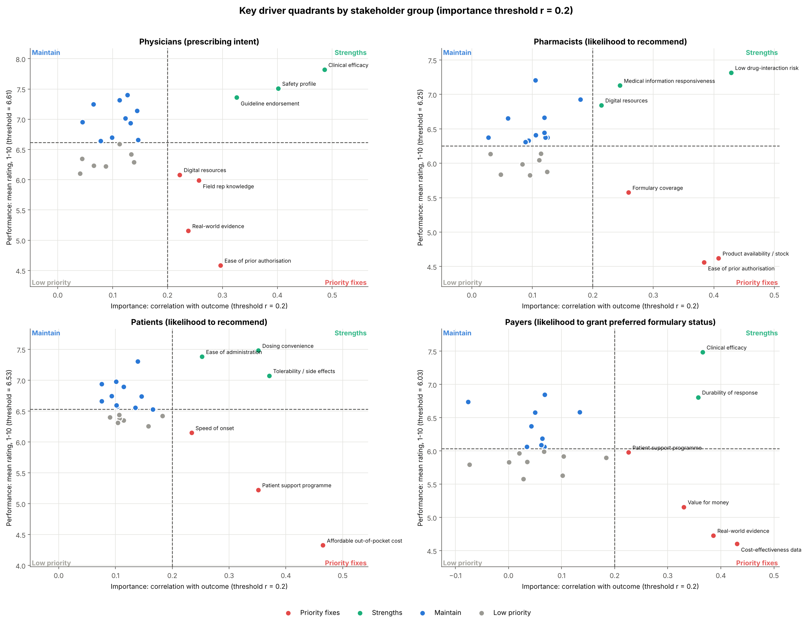
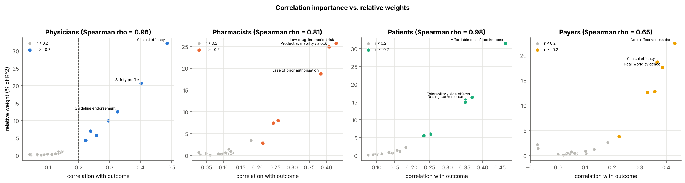
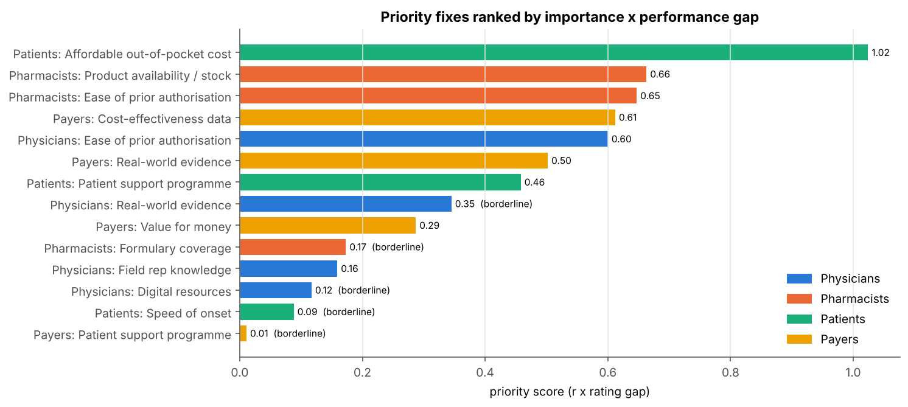

# Automated Key Driver Analysis Across Stakeholder Groups

A reusable Python framework that turns a multi-stakeholder perception survey into correlation-based driver importance, a 4-quadrant importance / performance chart (0.2 correlation threshold) and structured, testable hypotheses for each stakeholder group in a single timed run.

## Business goal

A pharmaceutical brand team surveys physicians, pharmacists, patients and payers every wave. Each wave the same questions come back: for each group, which attributes drive advocacy, how does the brand perform on them, and what should be fixed first? Done by hand, every group needs its own correlation table, chart and write-up, and the hypotheses are phrased differently each time.

This project packages that workflow into `src/kda.py` so that one function call produces, per group:

- driver importance (correlation with the outcome) and performance (mean rating),
- a labelled quadrant chart: **Strengths**, **Priority fixes**, **Maintain**, **Low priority**,
- hypothesis statements in a fixed structure (evidence, falsifiable statement, proposed test, action),

plus robustness checks so the team knows which calls to trust.

It is modelled on driver-analysis work I did for a pharma client. All data here is synthetic, and the therapy (Velarex) and manufacturer (Northbridge Therapeutics) are fictional.

## Data

`src/generate_data.py` (seed 314) writes `data/raw/stakeholder_survey.csv`: 2,350 respondents, 24 attribute ratings each, and one outcome. Each group has its own true drivers and performance profile, every rating loads on a shared respondent-level halo factor, and about 3% of ratings are "don't know" (missing). `--scale N` multiplies the sample size.

| Group | Respondents | Outcome (0-10) |
|---|---|---|
| Physicians | 600 | prescribing intent |
| Pharmacists | 400 | likelihood to recommend |
| Patients | 1,200 | likelihood to recommend |
| Payers | 150 | likelihood to grant preferred formulary status |

| Column | Type | Description |
|---|---|---|
| respondent_id | str | Synthetic respondent ID |
| stakeholder_group | str | Physicians, Pharmacists, Patients, Payers |
| region | str | Region A to D |
| 24 attribute columns | float, 1-10 | e.g. clinical_efficacy, safety_profile, tolerability, out_of_pocket_cost, prior_auth_ease, availability_in_stock, patient_support_program, real_world_evidence, cost_effectiveness_data (full list with labels in `data/raw/attribute_dictionary.csv`); blank = "don't know" |
| outcome_score | int, 0-10 | Group-specific outcome above |

## Approach

1. **Data overview** (`notebooks/01_data_overview.ipynb`): sample sizes, missingness, outcome distributions, mean ratings by group, and a halo check (inter-attribute correlation, Cronbach's alpha).
2. **Framework applied per group** (`notebooks/02_driver_framework_by_group.ipynb`): `run_kda` computes pairwise-complete Pearson correlations (importance) and means (performance), classifies each driver with an importance threshold of r = 0.2 and the group's average rating as the performance threshold, saves one quadrant chart per group, writes hypotheses, and times each group's run.
3. **Robustness** (`notebooks/03_robustness_relative_weights.ipynb`): Johnson's relative weights (a Shapley-style R^2 decomposition that handles correlated drivers) compared with correlation ranks; VIFs; a 70/30 holdout of the full regression vs. a mean baseline and a single-driver model; 500-sample bootstrap of each correlation to flag calls that sit too close to the 0.2 threshold.
4. **Hypothesis summary** (`notebooks/04_hypothesis_summary.ipynb`): all group-level hypotheses, priority fixes ranked by importance x rating gap, cross-stakeholder hypotheses, bootstrap confidence flags, and CSV exports.

### Framework API (`src/kda.py`)

```python
from kda import run_kda, cross_group_hypotheses, relative_weights, bootstrap_importance

results = run_kda(df, group_col="stakeholder_group", drivers=DRIVERS, outcome="outcome_score",
                  outcome_labels=OUTCOME_LABELS, labels=ATTRIBUTES, fig_dir="reports/figures")
results["Patients"].table       # importance, p-value, performance, gap, quadrant per driver
results["Patients"].hypotheses  # structured hypothesis rows
results["Patients"].seconds     # timed run for the group
cross_group_hypotheses(results) # drivers in the same actionable quadrant for 2+ groups
```

## Results

| Metric | Value |
|---|---|
| Automated run, all 4 groups incl. saving 4 charts | 1.20 s (0.25 to 0.36 s per group) |
| Automated run, all 4 groups, charts kept in memory | 0.24 s median of 5 runs |
| Drivers above r = 0.2 | Physicians 7, Pharmacists 6, Patients 6, Payers 6 (of 24) |
| Rank agreement, correlation vs. relative weights (Spearman) | 0.96 / 0.81 / 0.98 / 0.65 |
| Above-threshold drivers also in relative-weight top-k | 7/7, 5/6, 6/6, 6/6 |
| Holdout R^2, all-driver regression | 0.425 / 0.367 / 0.522 / 0.414 |
| Stable quadrant calls (bootstrap, 500 resamples) | 82 of 96 |
| Hypotheses generated | 37 group-level + 4 cross-stakeholder |

Group order in multi-value rows: Physicians / Pharmacists / Patients / Payers.

| Group | Top priority fix | r | Rating | Top strength |
|---|---|---|---|---|
| Physicians | Ease of prior authorisation | 0.296 | 4.59 | Clinical efficacy (r = 0.486) |
| Pharmacists | Product availability / stock | 0.408 | 4.62 | Low drug-interaction risk (0.429) |
| Patients | Affordable out-of-pocket cost | 0.465 | 4.33 | Tolerability (0.371) |
| Payers | Cost-effectiveness data | 0.431 | 4.61 | Clinical efficacy (0.366) |

Cross-stakeholder hypotheses: ease of prior authorisation (Physicians and Pharmacists), real-world evidence (Physicians and Payers) and the patient support programme (Patients and Payers) are shared fixes; clinical efficacy is a shared strength for Physicians and Payers. Five of the 14 priority fixes are flagged borderline by the bootstrap and should be re-tested next wave, most visibly in the 150-respondent payer sample.

Example generated hypothesis (PHY-01): *"If physicians rate ease of prior authorisation higher, their prescribing intent will increase: it is among the strongest correlates of prescribing intent (r = 0.30) but is rated 2.0 points below the group's average attribute rating (4.6 / 10)."*

On the efficiency claim: the 30% improvement on the original engagement was measured in analyst time across survey waves, which cannot be reproduced with synthetic data. What this repository measures is the automated run itself: every group's tables, charts and hypotheses are produced in about a second, in the same structure every time.







## Repository structure

```
key-driver-analysis/
  data/
    raw/stakeholder_survey.csv          synthetic survey (2,350 respondents)
    raw/attribute_dictionary.csv        attribute codes and labels
    processed/                          driver tables, timings, robustness checks, hypotheses
  notebooks/
    01_data_overview.ipynb
    02_driver_framework_by_group.ipynb
    03_robustness_relative_weights.ipynb
    04_hypothesis_summary.ipynb
  reports/figures/                      quadrant charts and other PNGs
  src/
    generate_data.py                    synthetic data generator
    kda.py                              key driver analysis framework
    plotting.py                         shared chart style
  requirements.txt
  LICENSE
```

## How to reproduce

```bash
pip install -r requirements.txt
python src/generate_data.py
cd notebooks
jupyter nbconvert --to notebook --execute --inplace 01_data_overview.ipynb 02_driver_framework_by_group.ipynb 03_robustness_relative_weights.ipynb 04_hypothesis_summary.ipynb
```

Notebook 04 reads the robustness output of notebook 03, so run them in order. Each notebook runs in under 20 seconds. Timings vary by machine.

## Tech stack

Python 3, pandas, NumPy, SciPy (correlations), scikit-learn (holdout regression), statsmodels (VIF), matplotlib, Jupyter.

## Note on data

All data in this repository is synthetic, generated by `src/generate_data.py`. It contains no real survey responses, client data, product or company names. The generator plants plausible driver structure so the framework can be demonstrated; the results above are what the code produces on that synthetic data.
